# Hey, I’m Satya.

I build thoughtful web products for learning, system design, and cloud infrastructure.

[Portfolio](https://satya00089.github.io/portfolio/) · [LinkedIn](https://linkedin.com/in/satya-subudhi) · [Email](mailto:satyasubudhi089@gmail.com)

## Selected work

<!--
  Each card is one animated SVG tile (assets/profile/<name>-tile.svg): screenshot, title,
  description and a glimmer that sweeps across it. Tiles sit in a row with no table,
  so GitHub adds no cell borders. To add a card, make a tile the same way and add an  here.
-->

Click a card for its live demo. Source code: <a href="https://github.com/satya00089/learn-algo">Learn Algo</a> · <a href="https://github.com/satya00089/diagrammatic">Diagramwise</a>

## A little about me

Senior Full-stack developer working across React, TypeScript, Python, FastAPI, AI Agents and cloud platforms.

More: [Portfolio](https://satya00089.github.io/portfolio/) · [Photos](https://photos.google.com/share/AF1QipNOdZHlXMpxhUmNx3ixc564gTdXRRWO4b6RKkh9KnQWGEEL1qKBqq_wofYMksV7PQ?key=V3p6bTZqZVlhQlVLakd1c29CR0xoNmVoeHcxVndn)
