# Hey, I’m Satya.

I build thoughtful web products for learning, system design, and cloud infrastructure.

[Portfolio](https://satya00089.github.io/portfolio/) · [LinkedIn](https://linkedin.com/in/satya-subudhi) · [Email](mailto:satyasubudhi089@gmail.com)

## Selected work

<!--
  Cards sit side by side in one row. Each card is a <td width="32%">, with a
  <td width="2%"></td> spacer between cards. To add a card, copy one card cell,
  place it after a spacer, and keep the widths summing to 100%.
  Each product image is an animated tile (e.g. assets/profile/learn-algo-tile.svg) with a glimmer that sweeps left to right.
  For a new card, make a tile the same way: embed its screenshot in an SVG and add the same sweep <rect>.
-->
<table width="100%">
  <tr>
    <td width="32%" valign="top">
      
      <h3>Learn Algo</h3>
      
An interactive way to explore algorithms, data structures, and machine learning—step through the logic and see how it works.

      
<a href="https://learn-algo.com/">Live demo</a> · <a href="https://github.com/satya00089/learn-algo">Source code</a>

    </td>
    <td width="2%"></td>
    <td width="32%" valign="top">
      
      <h3>Diagramwise</h3>
      
Design system architectures, understand the trade-offs, and turn review feedback into stronger designs.

      
<a href="https://diagramwise.com/">Live demo</a> · <a href="https://github.com/satya00089/diagrammatic">Source code</a>

    </td>
    <td width="2%"></td>
    <td width="32%" valign="top">
      
      <h3>Orchestrator</h3>
      
Plan cloud infrastructure visually, review the resource graph, and export Terraform when the design is ready.

      
<a href="https://orchestrator.next-zen.dev/">Live demo</a>

    </td>
  </tr>
</table>

## A little about me

Senior Full-stack developer working across React, TypeScript, Python, FastAPI, AI Agents and cloud platforms.

More: [Portfolio](https://satya00089.github.io/portfolio/) · [Photos](https://photos.google.com/share/AF1QipNOdZHlXMpxhUmNx3ixc564gTdXRRWO4b6RKkh9KnQWGEEL1qKBqq_wofYMksV7PQ?key=V3p6bTZqZVlhQlVLakd1c29CR0xoNmVoeHcxVndn)
