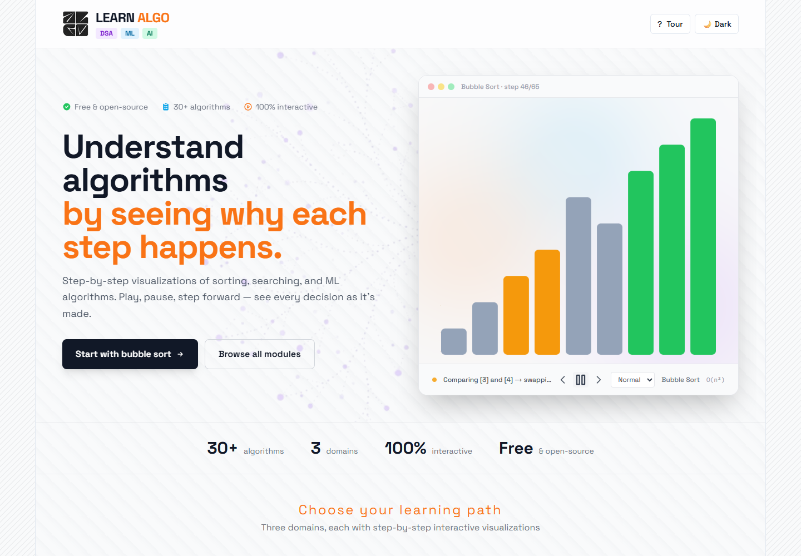
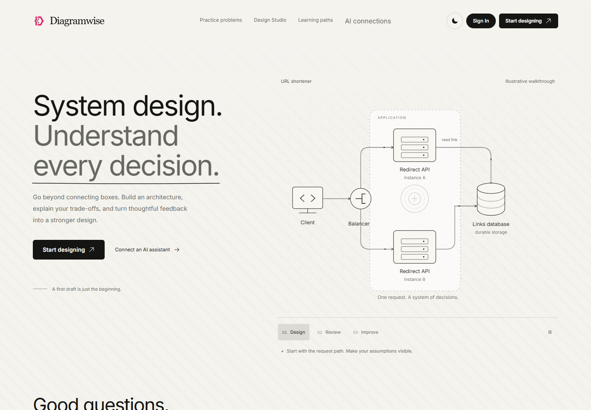
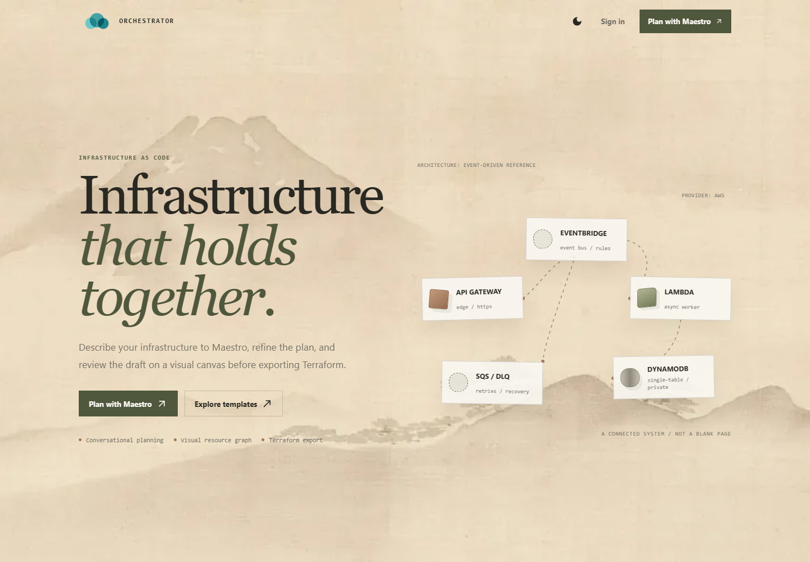

# Hey, I’m Satya.

I build thoughtful web products for learning, system design, and cloud infrastructure.

[Portfolio](https://satya00089.github.io/portfolio/) · [LinkedIn](https://linkedin.com/in/satya-subudhi) · [Email](mailto:satyasubudhi089@gmail.com)

## Selected work

### Learn Algo

An interactive way to explore algorithms, data structures, and machine learning—step through the logic and see how it works.

[Live demo](https://learn-algo.com/) · [Source code](https://github.com/satya00089/learn-algo)

### Diagramwise

Design system architectures, understand the trade-offs, and turn review feedback into stronger designs.

[Live demo](https://diagramwise.com/) · [Source code](https://github.com/satya00089/diagrammatic)

### Orchestrator

Plan cloud infrastructure visually, review the resource graph, and export Terraform when the design is ready.

[Live demo](https://orchestrator.next-zen.dev/)

## A little about me

Senior Full-stack developer working across React, TypeScript, Python, FastAPI, AI Agents and cloud platforms.

More: [Portfolio](https://satya00089.github.io/portfolio/) · [Photos](https://photos.google.com/share/AF1QipNOdZHlXMpxhUmNx3ixc564gTdXRRWO4b6RKkh9KnQWGEEL1qKBqq_wofYMksV7PQ?key=V3p6bTZqZVlhQlVLakd1c29CR0xoNmVoeHcxVndn)
